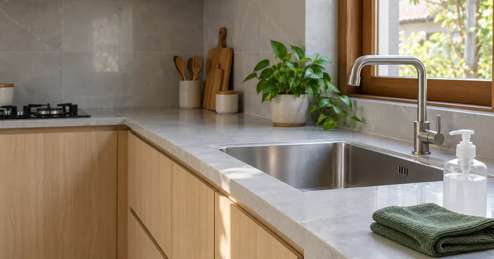

# Tips Bersih Rumah

Panduan membersihkan rumah berdasarkan bahan, dengan langkah jelas dan batas penggunaan. Tersedia dalam Bahasa Indonesia dan English.

[Buka web](https://tipsbersihrumah.rezaprama.com) · [Panduan Indonesia](docs/id.md) · [English guide](docs/en.md) · [Sumber foto dan metode](docs/sumber.md)

PageSpeed Insights, 21 Oktober 2026: **100 / 100 / 100 / 100**, mobile dan desktop untuk kedua beranda. [Laporan publik dan bukti](reports/pagespeed.md). Skor adalah hasil lab saat pengujian, bukan jaminan peringkat.



## Mulai dari masalahnya

- **Lantai lengket:** [Indonesia](https://tipsbersihrumah.rezaprama.com/tips/pel/) / [English](https://tipsbersihrumah.rezaprama.com/en/tips/pel/)
- **Kerak kamar mandi:** [Indonesia](https://tipsbersihrumah.rezaprama.com/tips/kerak/) / [English](https://tipsbersihrumah.rezaprama.com/en/tips/kerak/)
- **Jamur saat musim hujan:** [Indonesia](https://tipsbersihrumah.rezaprama.com/tips/dinding/) / [English](https://tipsbersihrumah.rezaprama.com/en/tips/dinding/)
- **Botol bayi:** [Indonesia](https://tipsbersihrumah.rezaprama.com/tips/botol/) / [English](https://tipsbersihrumah.rezaprama.com/en/tips/botol/)

38 panduan mengelompokkan kasus dari 11 foto referensi. Ada 10 tanya-jawab dan checklist harian/mingguan. Banjir, toren, jentik, dan septic tank mendapat perhatian untuk konteks Indonesia. Ini kurasi, bukan transkripsi lengkap seluruh baris foto.

**Gunakan satu produk sesuai label. Jangan mencampur pemutih dengan pembersih lain.** Ikuti manual material atau alat. [Baca aturan aman](https://tipsbersihrumah.rezaprama.com/aman/).

## Yang bisa dipakai

Web menyediakan pencarian, filter area, simpan tips, checklist tersimpan, mode terang/gelap, cetak, dan salin tautan. Bahasa memiliki URL terpisah; pergantian bahasa mempertahankan halaman tips. Tanpa JavaScript, seluruh panduan dan tanya-jawab tetap terbaca.

Di GitHub, buka panduan Indonesia atau English lalu kembangkan judul kasus. Checklist Markdown berubah ketika berkas disunting; checklist interaktif ada di web.

## Jalankan lokal

Node.js 22 atau lebih baru.

```sh
npm ci
npm run build
npm run dev
```

Buka `http://127.0.0.1:4173`. Setelah mengubah konten atau tampilan, jalankan `npm run build` lagi dan muat ulang browser.

```sh
npm test
npm run test:browser
npm run audit
```

Uji browser dan Lighthouse membutuhkan Google Chrome. Skrip memakai lokasi standar Windows; set `CHROME_PATH` untuk lokasi lain. Jalankan preview sebelum kedua perintah tersebut. Uji mencakup filter, simpanan, pergantian bahasa, checklist, mode tema, penyimpanan yang diblokir, fallback tanpa JavaScript, overflow layar, dan aksesibilitas otomatis. Pemeriksaan otomatis tidak menggantikan penilaian aksesibilitas manusia.

Audit produksi di PowerShell:

```powershell
$env:AUDIT_URL = 'https://tipsbersihrumah.rezaprama.com'
npm run audit
```

Hasil terbaru: [PageSpeed publik](reports/pagespeed.md), [Lighthouse lokal terhadap produksi](reports/results.md), dan [verifikasi fungsi](reports/verification.md). Skor adalah hasil lab pada waktu pengujian. Koneksi, perangkat, dan versi Lighthouse dapat mengubah hasil. GEO tidak punya skor baku 100/100; proyek menyediakan konten yang dapat ditelusuri, metadata, hreflang, sitemap, Article/FAQPage JSON-LD, dan `llms.txt`. Metadata tidak menjamin peringkat atau kutipan AI.

## Ubah konten

| Berkas | Fungsi |
| --- | --- |
| `src/content.mjs` | Isi bilingual, asal foto/baris, sumber, FAQ, checklist |
| `src/site.css` | Token warna, mode gelap, responsif, cetak |
| `src/app.js` | Interaksi di browser, tanpa framework runtime |
| `scripts/build.mjs` | HTML, aset AVIF/WebP, Markdown, sitemap, JSON-LD |
| `assets/` | Dua gambar ilustrasi sumber yang dibuat dengan imagegen |
| `sumber/` | 11 foto referensi asli, tidak diubah |
| `wrangler.jsonc` | Cloudflare Worker dengan static assets dan custom domain |

`npm run build` menghasilkan 82 halaman yang dapat diindeks, halaman 404, dokumen Markdown untuk web, serta dokumen GitHub. Edit `src/content.mjs`, bukan hasil di `docs/id.md` atau `docs/en.md`.

## Deploy

Hosting langsung Cloudflare Workers Static Assets, tanpa database atau server aplikasi. Domain ditetapkan di `wrangler.jsonc`:

```sh
npx wrangler login
npx wrangler deploy --dry-run
npm run deploy
```

Deployment langsung dari checkout ini. GitHub menyimpan sumber dan menjalankan pemeriksaan build. Push GitHub tidak otomatis mengubah produksi; gunakan `npm run deploy` setelah pemeriksaan lulus. Token Cloudflare tidak disimpan dalam repo.

## Privasi, sumber, dan hak

Tidak ada akun, iklan, atau pelacak analitik pihak ketiga. Pencarian berlangsung lokal. Tema, simpanan, dan checklist memakai `localStorage`. Cloudflare dapat memproses log teknis permintaan. Hapus data situs di browser untuk menghapus simpanan.

Foto referensi disediakan untuk proyek ini. Watermark dan hak pemilik asli tetap berlaku. Nama merek pada foto bukan rekomendasi belanja atau afiliasi. Dua foto ilustrasi dibuat dengan AI dan bukan bukti hasil pembersihan. [Prompt gambar](docs/aset.md). Geist memakai SIL Open Font License; ikon Phosphor memakai MIT License. Tidak ada izin lisensi baru yang diberikan untuk foto referensi.

Untuk koreksi, [buat issue](https://github.com/rezaprama/tipsbersihrumah/issues) dengan bahan, nomor foto/baris, dan rujukan yang mendukung.

## English

Practical, bilingual cleaning guides for homes in Indonesia. Browse the [English guide](docs/en.md), [live site](https://tipsbersihrumah.rezaprama.com/en/) or [source method](https://tipsbersihrumah.rezaprama.com/en/sumber/). Product labels and item-specific manuals take precedence. Never mix bleach with other cleaners. Reference photos are curated and corrected, not copied as instructions.
