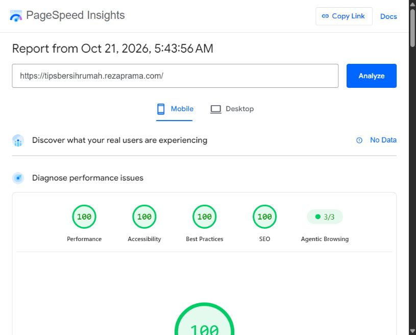
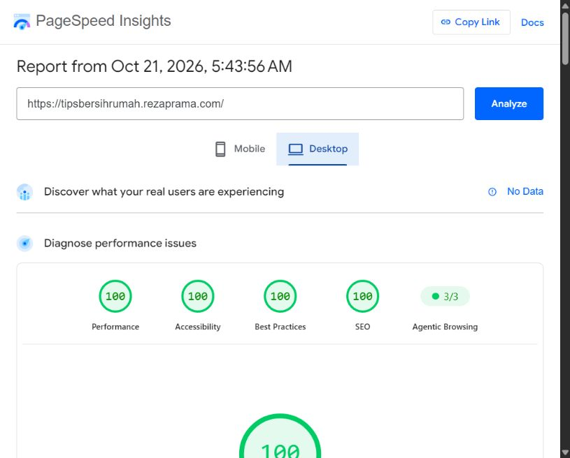
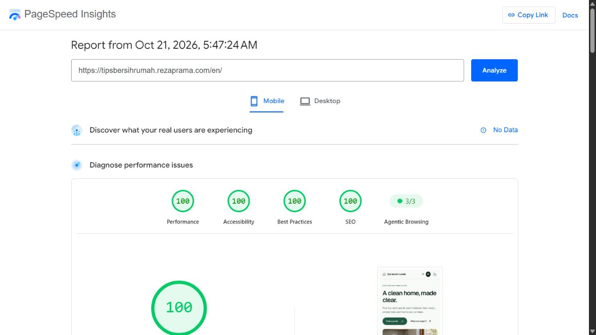
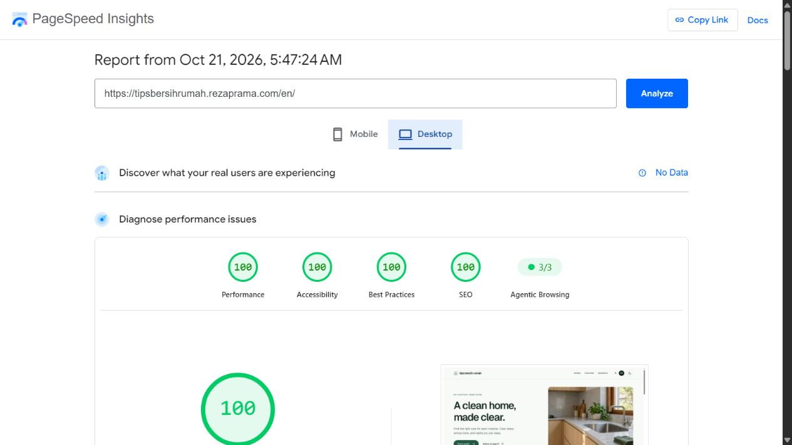

# PageSpeed Insights publik

Diuji pada **21 Oktober 2026**, melalui antarmuka publik Google PageSpeed Insights. Target adalah custom domain produksi, bukan localhost.

| Halaman | Perangkat | Performance | Accessibility | Best Practices | SEO |
| --- | --- | ---: | ---: | ---: | ---: |
| [Indonesia](https://pagespeed.web.dev/analysis/https-tipsbersihrumah-rezaprama-com/hdss05mgqo?form_factor=mobile) | Mobile | 100 | 100 | 100 | 100 |
| [Indonesia](https://pagespeed.web.dev/analysis/https-tipsbersihrumah-rezaprama-com/hdss05mgqo?form_factor=desktop) | Desktop | 100 | 100 | 100 | 100 |
| [English](https://pagespeed.web.dev/analysis/https-tipsbersihrumah-rezaprama-com-en/w9qeg14pke?form_factor=mobile) | Mobile | 100 | 100 | 100 | 100 |
| [English](https://pagespeed.web.dev/analysis/https-tipsbersihrumah-rezaprama-com-en/w9qeg14pke?form_factor=desktop) | Desktop | 100 | 100 | 100 | 100 |

Lighthouse 13.5.0, HeadlessChromium 153.0.8010.36. Mobile memakai emulasi Moto G Power dan Slow 4G. Desktop memakai emulasi Desktop dan custom throttling bawaan laporan Google.

- Indonesia: laporan pukul 05.43 WIB. FCP 1,2 s dan LCP 1,7 s di mobile; FCP 0,3 s dan LCP 0,4 s di desktop. TBT 0 ms.
- English: laporan pukul 05.47 WIB. FCP 1,2 s dan LCP 1,7 s di mobile; FCP 0,3 s dan LCP 0,4 s di desktop. TBT 0 ms.

Ini hasil lab untuk dua beranda pada waktu pengujian. Bukan jaminan skor semua URL atau semua pengujian berikutnya. Google belum memiliki data pengguna nyata/CrUX untuk situs baru ini. GEO tidak memiliki skor baku 100/100; skor Agentic Browsing di laporan Google bukan ukuran keberhasilan GEO.

## Bukti

### Indonesia, mobile

### Indonesia, desktop

### English, mobile

### English, desktop

## Metode dan batas

Endpoint REST PageSpeed membalas HTTP 429 karena kuota layanan. Pengujian berhasil melalui antarmuka PageSpeed publik; tautan laporan dan screenshot di atas berasal dari hasil yang terlihat di antarmuka tersebut.

[Audit Lighthouse dari komputer pengujian](results.md) memakai lokasi runner dan kondisi jaringan berbeda. Hasil lokal terhadap domain produksi dicatat terpisah, termasuk skor mobile yang lebih rendah, agar hasil tidak dipilih hanya yang terbaik.

Cloudflare beacon otomatis dicegah untuk HTML situs ini melalui `Cache-Control: no-transform`, sesuai [dokumentasi Cloudflare](https://developers.cloudflare.com/web-analytics/get-started/). Ini menghindari script tambahan dan pelanggaran CSP. Lihat [catatan verifikasi](verification.md) untuk konsekuensi kompresi dan pemeriksaan fungsi.
